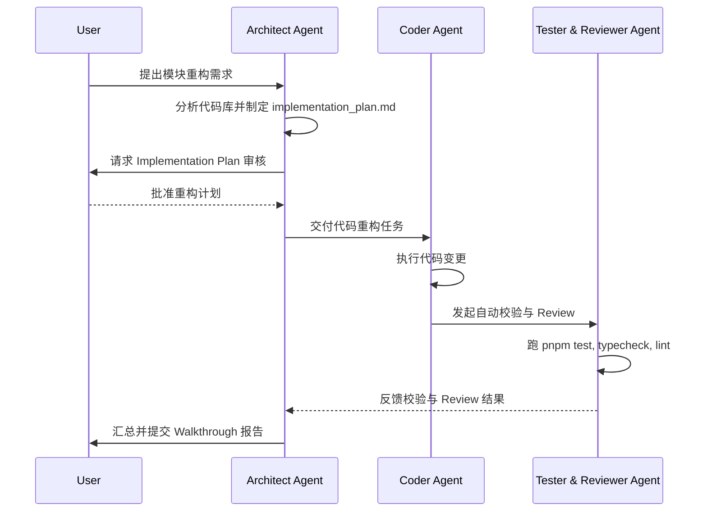

# Feature Refactor AgentTeam Specification

定义面向复杂模块或跨项目组件重构的多 Agent 协同方案（AgentTeam）。

## 团队角色构成

| 角色                        | 职责                                                             |
| :-------------------------- | :--------------------------------------------------------------- |
| **Architect Agent**         | 分析现有代码依赖图谱，制定重构 Plan（包含接口兼容性与 ADR 决策） |
| **Coder Agent**             | 执行代码重构编辑，保持函数签名与注释完整性，消除重复与面条代码   |
| **Tester & Reviewer Agent** | 运行单元测试、类型检查、Lint 校验，并对重构代码做 Code Review    |

## 协同工作流 (Workflow)

