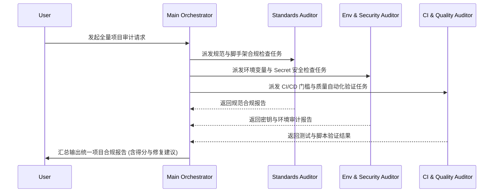

# Project Audit AgentTeam Specification

定义面向大中型项目全量合规审计的多 Agent 协同方案（AgentTeam）。

## 团队角色构成

| 角色                       | Subagent / Spec           | 主要职责                                                            |
| :------------------------- | :------------------------ | :------------------------------------------------------------------ |
| **Team Leader**            | Main Orchestrator         | 协调整个审计流程，拆解任务，汇总各 Agent 产出并向用户报告           |
| **Standards Auditor**      | `agents/auditor/AGENT.md` | 检查 `AGENTS.md`、`CLAUDE.md`、Husky Hooks、`playbook/` 原则合规度  |
| **Env & Security Auditor** | `agents/env-ops/AGENT.md` | 检查 L0~L3 密钥泄漏、`env-registry.yaml` 与 GitHub Environment 配置 |
| **CI & Quality Auditor**   | `dev-auditor` (CI Mode)   | 运行本地测试套件、`sync.sh validate`，检查 CI 4 大必选门槛          |

## 协同工作流 (Workflow)

## 交付产物

最终由 Leader 汇总输出 [audit-feedback-loop.md](../playbook/audit-feedback-loop.md)
格式的合规报告：

1. 本仓库待修复清单 (Tier A/C)
2. 标准库待反馈清单 (Tier B/C)
3. 综合评分与一条优先行动项
